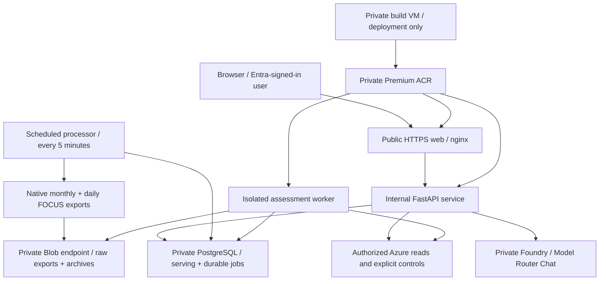

# MeghKoshaAI

MeghKoshaAI is a self-hosted Azure cost-assessment and FinOps dashboard for a single
organization. It combines native FOCUS cost exports with resource inventory,
Advisor recommendations and operational metrics.

**This branch is `feature/private-postgres-assessments`.** Its recommended deployment
keeps the original dashboard and uses **Blob export landing, private PostgreSQL
serving and isolated background processing**. The customer service-principal/no-login
proposal is not implemented here; Microsoft Entra sign-in remains required.

Application baseline verified on 28 October 2026:
`78233051bdfcb2b75cdbba7ed1a5cc07ed08f690`. Later documentation-only changes do not
represent a new application deployment or a new customer-load certification.

## Contents

- [Features](#features)
- [Architecture](#architecture)
- [Before deployment](#before-deployment)
- [Deploy the PostgreSQL configuration](#deploy-the-postgresql-configuration)
- [Access and export onboarding](#access-and-export-onboarding)
- [Configuration](#configuration)
- [Verification and recovery](#verification-and-recovery)
- [Scale validation](#scale-validation)
- [Local development and tests](#local-development-and-tests)
- [Security and operating boundaries](#security-and-operating-boundaries)

## Features

- **Original report UI:** 19 pages with shared scope, date, currency, theme and
  density controls; search, charts and resource drilldowns remain available.
- **Billing evidence:** FOCUS 1.2-preview exports, daily resource costs, 3-6 closed
  months of history and a daily month-to-date pull through yesterday. EffectiveCost
  is the assessment basis; it is not an unconditional invoice-reconciliation claim.
- **Optimization evidence:** compute, storage, network, Azure SQL and AI findings,
  with verified costs, estimates and missing evidence distinguished.
- **Exports and reports:** operator-controlled native export setup/scheduling,
  full/executive/chargeback/compliance/FinOps downloads, custom reports and filtered
  cost downloads. Email links require separately configured email delivery.
- **Budgets and actions:** budget reads and authorized create/update/delete
  operations, plus versioned FinOps action tracking. This full-feature mode is not
  a read-only deployment.
- **Chat:** the recommended deployment includes a private Foundry Model Router
  chatbot grounded in bounded report evidence. The separate hosted-agent executive
  narrator remains disabled unless explicitly configured and approved.

### Navigation

The top-level views are **Report**, **Chat** and **Schedules**.

| Report area | Pages |
|---|---|
| Dashboard | Executive Summary |
| Cost Management | Subscription Breakdown; History; Cost by Hour; Cost by Tags/Application; EA Pricing; Rate Optimization; Cost Anomalies; Budgets |
| Resources | Stale Resources; Governance & Risk |
| Analytics | Advisor Reconciliation |
| Recommendations | Savings Roadmap; Compute Optimization; Storage Optimization; Network Optimization; Azure SQL Optimization; AI Optimization |
| Reports | Action Plan |

## Architecture



### Serving and processing

1. Native Cost Management exports land in Blob Storage. Blob remains the raw-data
   and archive layer; it is not the normal dashboard report-serving path.
2. The API queues durable PostgreSQL jobs instead of building large assessments in
   a request. The worker streams/spools inputs and runs assessments in supervised
   subprocesses with row, byte, time and memory safeguards.
3. Only complete, lease-fenced publications become visible. PostgreSQL stores
   summaries, normalized daily costs, indexed detail records and bounded Chat
   evidence. Existing completed reports remain available during refresh.
4. The original UI uses bounded SQL projections. Financial totals and counts cover
   the complete authorized result, not just the visible detail page.
5. Full/custom/filtered report generation runs in background jobs using SQL
   snapshots. The API streams stored output chunks rather than rendering a large
   workbook in a dashboard request.

The API separates dashboard-read and work admission/connection budgets. Immutable
projection caches are bounded; authorization is checked before cached responses
are returned. Full queues and capacity failures return explicit errors rather than
partial financial totals or a synchronous Blob-processing fallback.

### Identity and networking

The browser obtains a delegated token for this API, not an ARM access token.
The API validates the token and checks the signed-in user's supported subscription
access. Backend Azure calls use explicit user-assigned managed identities.

- PostgreSQL, ACR and Foundry use private endpoints. PostgreSQL password
  authentication and public network access are disabled.
- A dedicated manual bootstrap job holds the PostgreSQL Entra administrator
  identity. API and worker database roles are not administrators.
- The web service is public HTTPS; API ingress is internal and the assessment
  worker has no ingress. Private dependencies do not make the entire website private.
- The build VM exists to build/push images to private ACR. It is not required for
  dashboard requests or assessments and has no VM public IP or inbound access.
  Its NAT gateway provides approved outbound connectivity.

## Before deployment

Use the [staged deployment guide](docs/manual-staged-deployment.md) for individual
stages or the [existing private-builder alternative](docs/manual-scalable-deployment.md)
when using your own approved build host. The procedure below is the recommended
new PostgreSQL deployment.

### Required tools and permissions

- PowerShell **7.4+**, Git, an authenticated GitHub CLI (`gh`), Azure CLI with
  Container Apps support, AZD **1.35+** and OpenSSH `ssh-keygen`.
  No Docker installation or VPN is required on the
  management laptop for the VM build path.
- An operator authorized to create hosting resources and assign roles at the
  approved hosting and target-subscription scopes.
- Entra authority to configure the two single-tenant app registrations and
  federation. Tenant policy may require administrator consent or an approved
  Service Tree ID; the script cannot bypass either requirement.
- Test the intended users' subscription authorization. Group-only, custom-role or
  management-group grants are not a blanket guarantee of support by the app's
  conservative authorization checks.
- Hosting and target subscriptions in the supported single-tenant configuration.
  Check Cost Management export eligibility and billing access for each subscription.
- Sufficient Central India PostgreSQL/ACA/VM capacity and East US 2 quota for the
  exact approved Model Router deployment. Check current availability, policy and
  data-residency requirements; do not assume another tenant has the same quota.

Register `Microsoft.CostManagementExports` in the subscription hosting the export
destination if it is not already registered. Other required providers must also
be registered through the customer's approved provisioning process:

```powershell
az provider show --namespace Microsoft.CostManagementExports `
    --subscription '<hosting-subscription-uuid>' --query registrationState --output tsv

# Authorized administrator only, if registration is missing:
az provider register --namespace Microsoft.CostManagementExports `
    --subscription '<hosting-subscription-uuid>'
```

### Operating approvals

Review network/address-space policies, private DNS, builder outbound feeds, Blob
trusted-service ingress and ongoing costs before proceeding.

**Resolve automatic shutdown rules before customer handover.** A governance
application can explicitly stop PostgreSQL even while the containers remain
running. Obtain an approved always-on exception if needed; do not invent exemption
tags, remove governance access or implement an unapproved restart loop.

The default PostgreSQL server is not configured for high availability. Review
backup, recovery, availability and retention requirements before treating this
reference configuration as a production service.

## Deploy the PostgreSQL configuration

### 1. Use the correct branch and customer context

Run in PowerShell 7.4+. Replace every placeholder and use a new environment name.
Do not copy another deployment's `.azure` directory, identities or credentials.

```powershell
$ErrorActionPreference = 'Stop'
$PSNativeCommandUseErrorActionPreference = $true

$TenantId = '<customer-tenant-uuid>'
$HostingSubscriptionId = '<hosting-subscription-uuid>'
$TargetSubscriptionIds = @(
    '<assessed-subscription-uuid-1>'
    '<assessed-subscription-uuid-2>'
)
$EnvironmentName = 'meghkoshaai-customer-pg'

git clone --branch feature/private-postgres-assessments --single-branch `
    https://github.com/Saby007/MeghKoshaAI.git MeghKoshaAI-customer-pg
Set-Location .\MeghKoshaAI-customer-pg
git rev-parse HEAD
git status --short

gh auth login --hostname github.com --web
gh auth status --hostname github.com
az login --tenant $TenantId
az account set --subscription $HostingSubscriptionId
azd auth login --tenant-id $TenantId
azd auth login --check-status
```

Review the exact published feature commit. The builder requires a clean checkout
and a public repository. The historical application baseline predates the
authenticated GitHub preflight fix; use the reviewed feature revision containing
the fix for new customer deployments. This changes source validation, not
application/UI, database or infrastructure behavior.

`gh` authentication is local to the management machine; no GitHub token is
extracted by the script or copied to Azure/the builder. Use an organization-approved
GitHub session; public-source validation does not require repository write access.
`-SkipLogin` only affects Azure/AZD checks, not GitHub authentication.

### 2. Review and execute the existing entry point

```powershell
$deployment = @{
    EnvironmentName = $EnvironmentName
    AssessmentMode = 'postgres'
    SubscriptionId = $HostingSubscriptionId
    TargetSubscriptionId = ($TargetSubscriptionIds -join ',')
    Location = 'centralindia'
    FoundryLocation = 'eastus2'
    PrivateRegistry = $true
    BlobDataProtection = $true
    BuilderVmSize = 'Standard_D2s_v5'
}

# Add only if the tenant requires an approved Service Tree ID:
# $deployment.ServiceManagementReference = '<approved-service-tree-uuid>'

.\scripts\deploy-end-to-end.ps1 @deployment -PlanOnly

# Run only after reviewing the plan, customer context, permissions and costs:
.\scripts\deploy-end-to-end.ps1 @deployment
```

`PlanOnly` makes no Azure calls: it is not a quota, policy or ARM what-if check.
The execution path previews provisioning and asks for one explicit rollout
approval. It then initializes, provisions, builds/pushes private images, bootstraps
the database, configures sign-in and target grants, releases immutable images,
verifies basic readiness and deallocates the builder.

`-SkipLogin` is optional and is omitted above. Without it, existing Azure/AZD
sessions are checked and login is requested when needed; it does not affect the
application's sign-in screen. `-ApproveAll` is only for separately approved
unattended execution.

**Do not use raw `azd up`, `azd deploy`, the Blob-mode helper or mutable `:latest`
images for this PostgreSQL flow.** Legacy compatibility flags such as
`-SkipProcessor`, `-SkipIdentityBootstrap`, `-SkipPreview`, `-MaxAttempts` and
`-SkipModelAvailabilityCheck` are not a PostgreSQL retry/skip mechanism.

The script resumes verified checkpoints for the same source; it does not guarantee
automatic recovery from every provider-settlement error or perform an implicit
upgrade of a released environment to a different source/schema. It also refuses
the separately held `meghkoshaai-dev` environment. Do not copy restore/reuse or
registration-migration flags into a fresh customer deployment.

### 3. Complete export onboarding and acceptance

Successful provisioning is not successful data ingestion. Complete the next
section before running exports, then follow [verification](#verification-and-recovery).
No new Azure deployment was performed to produce this README.

## Access and export onboarding

### Required access

| Identity or caller | Access | Scope / responsibility |
|---|---|---|
| Signed-in user | Supported subscription read access; operation-specific permission for controls | Subscriptions they are authorized to view/manage |
| API MI | Reader **and** Cost Management Contributor | Each assessed subscription |
| Processor/assessment MI | Reader **and** Cost Management Contributor | Each assessed subscription |
| Monthly native export MI | Storage Blob Data Contributor | Owned `cost-exports` container |
| Daily native export MI | Storage Blob Data Contributor, separately | Same owned `cost-exports` container |
| API/web/processor/bootstrap MI | Appropriate AcrPull and Blob/Foundry grants | Owned resources, declared by infrastructure |
| Builder MI | AcrPush | Owned ACR |
| Dedicated DB bootstrap MI | PostgreSQL Entra administrator | Owned PostgreSQL server only |
| API / worker SQL roles | Serving/control / background-publication grants | `meghkosha` database; no runtime DDL ownership |

The staged Permissions step grants both runtime identities Reader and Cost
Management Contributor: **four runtime assignments per assessed subscription**.
It is not the old three-assignment setup. Creating budgets or exports is a write
operation; this deployment must not be presented as Reader-only.

The API also has explicitly provisioned setup permissions on its owned Storage
scope. Review these grants. Subscription access, storage setup and native-export
writer permissions are different authorization boundaries.

### Configure, verify access, then run

1. Sign in as an authorized setup operator and open **Schedules**.
2. Use **Configure export**, review the fixed destination and explicitly approve
   destination-role assignment. Verify both closed-month and daily definitions.
   Merely opening or refreshing Schedules does **not** create them or a schedule.
3. Before starting a schedule or pressing Export, verify both native identities'
   destination grants. There must be **2 x N export writer bindings** for N
   assessed subscriptions, in addition to the runtime assignments above.
4. Allow propagation and verify a fresh native execution reaches **Completed**.
   A role assignment appearing in ARM, an active schedule or a queued run is not
   proof that Azure can deliver the files.
5. Enable the app schedule with an understood UTC daily time and approved monthly
   start. Use Export to request the closed-month backfill.

Monthly and daily exports have different system-assigned identities. They are
created in the assessed subscriptions, outside the app resource group. Deleting
and recreating the app's Storage account can remove their destination grants
while leaving the export definitions and old run history intact.

**Re-audit both identities after any rebuild.** Configure export verifies existing
definitions; it is not a blanket repair of missing grants on retained definitions.

### Audit the actual customer bindings

After both definitions exist, use the customer variables from the deployment
session. This example is read-only and refuses a mismatched tenant/destination:

```powershell
$state = azd env get-values --environment $EnvironmentName --output json |
    ConvertFrom-Json -AsHashtable
$StorageId = [string]$state.COST_EXPORT_STORAGE_RESOURCE_ID
$ContainerScope = "$StorageId/blobServices/default/containers/cost-exports"
$WriterRole = 'ba92f5b4-2d11-453d-a403-e96b0029c9fe'
$exportNames = @([string]$state.COST_EXPORT_NAME, [string]$state.COST_EXPORT_DAILY_NAME)

if (-not $TargetSubscriptionIds.Count -or
    $state.AZURE_SUBSCRIPTION_ID -ne $HostingSubscriptionId -or
    $state.AZURE_TENANT_ID -ne $TenantId -or
    $StorageId -notmatch "^/subscriptions/$HostingSubscriptionId/resourceGroups/[^/]+/providers/Microsoft.Storage/storageAccounts/[a-z0-9]+$" -or
    $exportNames[0] -eq $exportNames[1]) {
    throw 'Environment or export destination does not match the approved customer.'
}

$bindings = @(
    foreach ($subscription in $TargetSubscriptionIds) {
        $subscription = ([guid]$subscription).ToString()
        foreach ($exportName in $exportNames) {
            if ($exportName -notmatch '^[A-Za-z0-9][A-Za-z0-9._-]{0,127}$') {
                throw 'Invalid environment-generated export name.'
            }
            $exportId = "/subscriptions/$subscription/providers/Microsoft.CostManagement/exports/$exportName"
            $export = az rest --subscription $subscription --method get `
                --url "https://management.azure.com$exportId`?api-version=2025-03-01" `
                --output json | ConvertFrom-Json
            $principal = [guid]$export.identity.principalId
            if ($principal -eq [guid]::Empty -or $export.id -ne $exportId -or
                $export.identity.type -ne 'SystemAssigned' -or
                $export.identity.tenantId -ne $TenantId -or
                $export.properties.deliveryInfo.destination.resourceId -ne $StorageId -or
                $export.properties.deliveryInfo.destination.container -ne 'cost-exports') {
                throw "Export identity or destination mismatch: $subscription / $exportName"
            }
            [pscustomobject]@{
                Subscription = $subscription
                Export = $exportName
                PrincipalId = $principal.ToString()
            }
        }
    }
)
if ($bindings.Count -ne 2 * $TargetSubscriptionIds.Count) {
    throw 'Both export identities were not verified for every target subscription.'
}
$assignments = @(az role assignment list --subscription $HostingSubscriptionId `
    --scope $ContainerScope --output json | ConvertFrom-Json)
$missing = @($bindings | Where-Object {
    $binding = $_
    -not @($assignments | Where-Object {
        $_.principalId -eq $binding.PrincipalId -and $_.scope -eq $ContainerScope -and
        $_.roleDefinitionId -like "*/$WriterRole" -and
        [string]::IsNullOrWhiteSpace([string]$_.condition)
    }).Count
})
$bindings | Format-Table Subscription, Export, PrincipalId
if ($missing.Count) {
    $missing | Format-Table Subscription, Export, PrincipalId
    throw 'Missing container writer grants. Repair approved bindings before running exports.'
}
Write-Host "Verified $($bindings.Count) monthly/daily container writer bindings."
```

If a grant is missing, an authorized administrator must review and approve the
verified principal and exact container scope before applying:

```powershell
az role assignment create --subscription $HostingSubscriptionId `
    --assignee-object-id '<verified-monthly-or-daily-export-principal-id>' `
    --assignee-principal-type ServicePrincipal `
    --role 'Storage Blob Data Contributor' --scope $ContainerScope
```

Repeat the audit afterward. Do not copy another deployment's principal IDs,
substitute broad Owner grants, or disable strict command-error handling.

### Blob network posture

The template's native-export option requests Storage public network access Enabled
with **default Deny + AzureServices bypass**; public blobs and shared keys remain
disabled. The reference environment's effective posture is public access Disabled
with the same Deny/bypass settings.

To match that stricter posture, an approved operator can apply this after the final
provisioning stage, before export setup:

```powershell
$state = azd env get-values --environment $EnvironmentName --output json |
    ConvertFrom-Json -AsHashtable
$StorageId = [string]$state.COST_EXPORT_STORAGE_RESOURCE_ID
$ResourceGroup = [string]$state.AZURE_RESOURCE_GROUP
if ($state.AZURE_SUBSCRIPTION_ID -ne $HostingSubscriptionId -or
    $StorageId -notmatch "^/subscriptions/$HostingSubscriptionId/resourceGroups/$ResourceGroup/providers/Microsoft.Storage/storageAccounts/[a-z0-9]+$") {
    throw 'Storage does not belong to the approved deployment environment.'
}
$StorageName = ($StorageId -split '/')[-1]
az storage account update --subscription $HostingSubscriptionId `
    --resource-group $ResourceGroup --name $StorageName `
    --public-network-access Disabled --default-action Deny --bypass AzureServices
az storage account show --subscription $HostingSubscriptionId `
    --resource-group $ResourceGroup --name $StorageName `
    --query '{publicNetworkAccess:publicNetworkAccess,defaultAction:networkRuleSet.defaultAction,bypass:networkRuleSet.bypass,sharedKeys:allowSharedKeyAccess,publicBlobs:allowBlobPublicAccess}' `
    --output json
```

Expected result: Disabled / Deny / AzureServices / false / false.
This is a post-deployment operator step, not a new template parameter. A subsequent
provision can request Enabled again; recheck after each provision. Configured
trusted-service exceptions can remain effective with public access Disabled,
as documented in the [Storage firewall limitations](https://learn.microsoft.com/azure/storage/common/storage-network-security-limitations).
Do not open ACR/PostgreSQL/Foundry or add broad network exceptions to repair RBAC.

## Configuration

These are AZD environment inputs, not browser settings. The staged runner sets
the AI/PostgreSQL/private-builder profile; use overrides only after reviewing
capacity and policy. See [infra/main.bicepparam](infra/main.bicepparam) for mappings.

| Setting | Recommended/default value | Purpose |
|---|---|---|
| `APP_ASSESSMENT_MODE` | `postgres` | Explicit `blob` is legacy compatibility, not the recommended scalable deployment |
| `APP_POSTGRES_SKU` / `APP_POSTGRES_TIER` | `Standard_D2ds_v5` / `GeneralPurpose` | PostgreSQL sizing |
| `APP_POSTGRES_VERSION` / `APP_POSTGRES_STORAGE_GB` | `16` / `128` | Database version and storage; autogrow enabled |
| `APP_MIN_REPLICAS` | `2` in the staged flow | API/web minimum replicas |
| `APP_ASSESSMENT_WORKER_CPU` / `APP_ASSESSMENT_WORKER_REPLICAS` | `4.0` / `1` | 8 GiB worker; bounded background concurrency |
| `APP_ASSESSMENT_POOL_SIZE` / `APP_ASSESSMENT_QUEUE_CAPACITY` | `5` / `50` | Per-process SQL pool and durable queue budgets |
| `APP_ASSESSMENT_LIMITS` | `{}` | Validated overrides for row, byte, time, response, read/work and Azure pacing budgets |
| `APP_PRIVATE_REGISTRY` / `APP_REGISTRY_BUILD_MODE` | `true` / `private-runner` | Private ACR and private build host |
| `APP_ENABLE_PRIVATE_BUILDER` / `APP_PRIVATE_BUILDER_VM_SIZE` | `true` / `Standard_D2s_v5` | Default VM build path |
| `FOUNDRY_LOCATION` | `eastus2` | Separate approved model region |
| `APP_MODEL_DEPLOYMENTS` | Model Router `2025-11-18`, GlobalStandard, capacity 20 | Exact model contract set by the staged runner |
| `APP_ENABLE_CHAT_RUNTIME` / `APP_ENABLE_AI_RUNTIME` | `true` / `false` | Chat enabled; separate hosted narrator disabled |
| `APP_EXPORT_TRUSTED_SERVICES` | `true` in the end-to-end flow | Explicit Blob trusted-service exception |
| `APP_BLOB_DATA_PROTECTION` | `true` when `-BlobDataProtection` is supplied | Versioning and blob/container soft delete |
| `APP_PROCESSOR_CRON` / `APP_EXPORT_PARALLEL_MONTHS` | `*/5 * * * *` / `1` | Scheduler tick and monthly per-subscription concurrency |
| `APP_DAILY_EXPORT_RETENTION_DAYS` / `APP_CLOSED_MONTH_RETENTION_DAYS` | `60` / `214` | Raw export lifecycle retention, not PostgreSQL snapshot retention |

`APP_ASSESSMENT_FOUNDATION_ONLY` and `APP_ASSESSMENT_DB_BOOTSTRAPPED` are staged
release controls, not toggles to bypass failed bootstrap. Schema/image updates,
Foundry account restoration and owned-registration migration require reviewed
individual stages.

## Verification and recovery

### Acceptance checklist

- Correct reviewed commit and immutable API/web/worker image digests.
- Root, `/api/health`, `/api/ready` and `/api/auth/config` respond as intended;
  unauthenticated report access is denied. Running is not the same as Ready.
- Two API and two web replicas ready, one assessment worker, no restart loop.
- Private ACR/PG/Foundry; password-disabled Entra-only PostgreSQL.
- Correct runtime grants, both export writer bindings on every subscription,
  and a fresh Completed daily/monthly output for the intended periods.
- Completed background assessment published to PostgreSQL, then verified original
  UI, filters, downloads and Model Router Chat for the authorized scope.
- Governance/always-on approval and builder deallocation verified.

```powershell
.\scripts\deploy-staged.ps1 -Stage Verify -EnvironmentName $EnvironmentName `
    -Apply -ApproveAzureChanges
```

That stage checks basic runtime/image/private readiness, not all signed-in data
flows. Native Queued/DataReady states are not Completed. Monthly/daily scheduling
and retries run separately; failed months can wait while later eligible months run.
A daily cycle that exhausts retries stays failed for that day unless an approved
guarded recovery is performed or the next eligible daily cycle begins.

### Known deployment caveats

| Symptom | Action |
|---|---|
| GitHub source validation fails | Current source checks use authenticated `gh api` requests to github.com, retaining public-repository and exact-commit validation. Verify `gh auth status --hostname github.com` and the reported authentication/rate/network error. No anonymous fallback is attempted. Older application-baseline scripts used the shared-IP anonymous quota; update to the reviewed preflight fix rather than repeatedly waiting or injecting global HTTP authorization headers. |
| AZD advertises a patch but WinGet returns `0x8A15002B` | No applicable package upgrade was found. AZD 1.37.1 meets this deployment's requirement; do not reinstall or disable deployment error handling just to remove the notice. |
| Quota, SKU, model, policy or consent failure | Stop for capacity/administrator approval. Do not open endpoints or silently change regions/roles/models. |
| Foundry `Accepted` / `RequestConflict` | Inspect the owned account and wait for provider settlement before resuming the same-source stages. Restore and reuse are different states; do not set flags blindly or purge resources. |
| PostgreSQL admin operation while inaccessible | Verify the server is Ready and privately reachable before retrying bootstrap. Never attest success manually. |
| `AccessToStorageAccountDenied` | Check both monthly/daily identities, exact destination, data roles, trusted-service settings and propagation. Repeated starts do not repair access. |
| Old completed run history after a Storage rebuild | Generate fresh output after rechecking grants. Old history does not prove files exist in recreated storage. |
| Partial foundation failure before builder outputs are saved | Inspect and deallocate only the owned idle builder; verify cleanup rather than assuming it happened. |
| PostgreSQL Stopped overnight | Identify the stop caller and obtain the governance owner's approved shutdown exception. This is not a database-memory or UI failure. |
| `JobStartOverrideAuthorizationFailed` | Intentional container/init-container overrides require the manual caller's `Microsoft.App/jobs/start/action` and `Microsoft.App/jobs/write` on that job. Omit override fields entirely on trigger-only starts; empty arrays count. Scheduled executions are unchanged. |

The private builder is deallocated after the rollout; its disk, NAT gateway and
public egress IP remain billable. ACR Premium, PostgreSQL, replicas, private
endpoints, logging and model usage also incur charges. This footprint is not an
automatically deleted or cost-free environment.

## Scale validation

Local synthetic checks at the application baseline used real PostgreSQL 16.15:

| Workload / measurement | Observed result |
|---|---|
| Resources / input FOCUS rows | 15,000 / 1,000,000 |
| Retained daily history | 61 days / 915,000 normalized points |
| Readers during atomic publication | 10 concurrent; 9,090 requests |
| Summary p95 during publication | About 0.06 seconds |
| Complete cost metrics on the persisted fixture | About 1.42 seconds cold; 0.20 seconds warm p95 with 10 readers |
| Pipeline peak working set | About 412 MiB |
| Separate million-row anomaly detector peak | About 176 MiB |

All 19 pages were compared against the original fixture-driven UI in dark/light
browser checks; six executive/subscription/SQL screenshot pairs were identical.
The baseline had 876 API and 330 frontend test passes, with separately enabled
native-SQL, scale and browser gates.

These are not customer Azure latency guarantees or proof of unlimited-load crash
freedom. Test representative billing history, tag/meter cardinality, concurrent
users, worker publication and restart recovery in the customer's approved
environment. Five subscriptions with 15,000 resources each exceed the tested
single-scope resource count.

## Local development and tests

Use Python 3.12+, Node 24+ and PowerShell 7.4+. Runtime container images use their
own pinned Python/base-image versions; do not infer them from the local interpreter.

```powershell
# Backend terminal, from the repository root:
Set-Location .\api
python -m venv .venv
.\.venv\Scripts\Activate.ps1
python -m pip install -r requirements-dev.txt
python -m uvicorn main:app --host 127.0.0.1 --port 8002
```

```powershell
# Separate frontend terminal, from the repository root:
Set-Location .\web
npm ci
npm run dev
```

Use [api/.env.example](api/.env.example) and [web/.env.example](web/.env.example)
as configuration references. Supply approved variables to the API process;
copying a file alone does not load it. Live Azure calls require an appropriate
managed-identity/private-connectivity runtime. A local `az login` is not a fallback
for this explicit managed-identity implementation. Without valid API identity
configuration, sign-in fails closed.

For synthetic regression tests:

```powershell
.\scripts\test-baseline.ps1 -Suite All
```

The runner supports `Backend`, `Frontend`, `Build` and `Browser` separately.
Install the project's locked dependencies first. Browser tests use the configured
Edge channel; live identity checks need their separately approved environment.

Opt-in SQL/scale tests require `ASSESSMENT_TEST_DSN` pointing to a **dedicated
loopback database named `meghkosha_test`** and, for the million-row gates,
`ASSESSMENT_RUN_SCALE_TESTS=1`. Tests reset fixture tables: never target a customer,
shared or deployed application database. See
[the PostgreSQL tests](api/tests/test_assessment_postgres.py).

## Security and operating boundaries

- Single-organization reference deployment, not a multi-tenant SaaS service.
- Independently validated Entra API tokens and tenant/subscription authorization;
  no anonymous/no-login mode or browser client secrets.
- Explicit managed identities, verified TLS for PostgreSQL and least-privilege
  runtime database grants. Only bootstrap has database-administrator authority.
- Budget/export changes and destination-role assignment require their explicit
  controls and authorized operators; they are not automatic side effects of
  opening a report.
- Secretless app-registration federation does not bypass tenant consent or
  Conditional Access. The one-command path does not automatically grant
  administrator consent.
- Runtime images are immutable, digest-pinned and non-root. Public source checks
  do not justify copying GitHub tokens, Azure sign-in state or private keys to a VM.
- Do not commit `.azure`, `.env`, credentials, auth caches or customer billing data.
  Cost/identity responses remain private/no-store.
- Infrastructure and readiness success are prerequisites, not a substitute for
  signed-in feature, data, privacy, availability and load acceptance.

Review [the infrastructure](infra/main.bicep),
[staged deployment controls](docs/manual-staged-deployment.md) and
[manual private-network verification](docs/manual-scalable-deployment.md)
before deploying or upgrading a customer environment.
