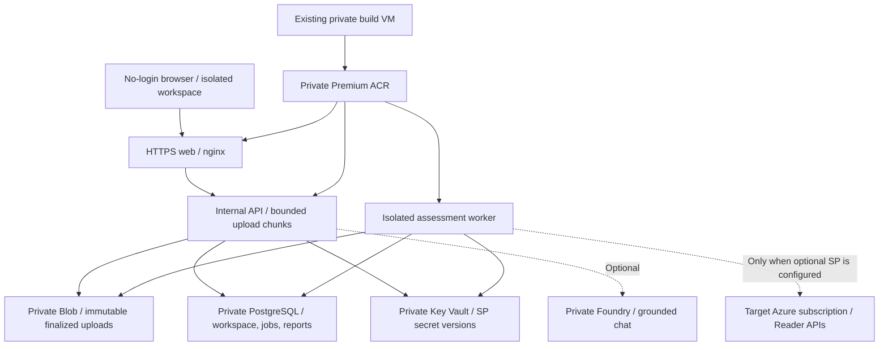

# MeghKoshaAI - manual FOCUS workspaces

Branch: `feature/manual-focus-service-principal`, based on the private PostgreSQL
feature branch. The [implementation plan and status](.azure/deployment-plan.md)
record the requirements, architecture, tasks and verification results.

## What changed

- **No application login:** opening the site creates an isolated anonymous browser
  workspace. Other visitors cannot see its reports, credentials or uploads.
- **One subscription at a time:** enter the target subscription ID in **Admin**.
- **Manual FOCUS input:** upload FOCUS 1.2 (dataset version `1.2-preview`) CSV or
  gzip CSV files, including all report
  partitions. A successful replacement replaces the active dashboard; reports
  are not silently appended.
- **Any uploaded duration:** short/partial periods and histories beyond six months
  are supported. There is no 12-month selection or 366-day query restriction.
- **Optional service principal:** FOCUS alone creates financial dashboards. Add
  tenant ID, client ID and client secret to enable live Azure evidence using a
  manually provisioned **Reader** service principal.
- **No budgets or automated exports:** no budget controls, native export setup,
  scheduled cost pulls, target IAM grants, or user-sign-in registration stages.
- **Private PostgreSQL and larger ACA resources:** background workers ingest
  evidence; the original report uses bounded SQL projections and pagination.
- **Private ACR is preserved:** Premium, public access disabled, admin disabled,
  existing private endpoints, managed-identity pulls and private build VM path.

## Using the application

1. Open **Admin** and save the target subscription UUID.
2. Leave service-principal credentials off for a FOCUS-only financial dashboard,
   or supply all three credential fields for Azure enrichment.
3. Select the CSV/gzip report files and choose **Upload and generate dashboard**.
4. Follow upload and background-job status. Interrupted uploads can be resumed
   after reselecting the same files; existing chunk hashes are checked.
5. On success, the Report view opens with the new dataset and its complete
   uploaded date range. The previous complete report stays available while a
   replacement is processing or if it fails.

Without a service principal, inventory, Advisor, uptime, governance and
optimization sections requiring Azure APIs explicitly show unavailable evidence.
They do not fall back to the visitor's account or the hosting managed identity.
Adding/removing credentials can rebuild the already uploaded report.

The customer creates the service principal and Reader grant themselves. Connection
validation checks authentication and subscription readability, not a proof that
there are no additional/inherited role assignments. The application issues
read-only target operations even if an overly privileged principal is supplied.
Some recommendation/metric APIs may require permissions beyond Reader; those
optional results remain unavailable rather than blocking uploaded financial data.

## Architecture



Files transfer in 8 MiB chunks through the API, so the browser does not need
network access to private storage. PostgreSQL persists resumable checkpoints.
The worker replays CSV input without retaining all raw resource/day records in
Python memory. Daily evidence is normalized using SQL staging and bounded COPY
batches; financial totals cover all selected evidence, not just the visible page.
Only lease-fenced, complete publications replace the workspace's active dataset.

Target Azure calls use `ClientSecretCredential`. Hosting managed identities still
authenticate to PostgreSQL, Blob, Key Vault, ACR and optional Foundry. Target
tenant and hosting tenant are separate configuration concepts.

## Deploy

Use the [manual FOCUS deployment guide](docs/manual-focus-deployment.md). It
includes the plan-only command, prerequisites, approved rollout, stages, sizing,
recovery and migration restrictions.

```powershell
.\scripts\deploy-end-to-end.ps1 `
    -EnvironmentName 'meghkoshaai-manual' `
    -SubscriptionId '<hosting-subscription-uuid>' `
    -PlanOnly
```

The staged workflow is **Initialize -> Foundation -> Build -> Bootstrap ->
Release -> Verify -> StopBuilder**. There are no Identity or Permissions stages.
The existing private builder builds the exact reviewed, published source commit;
it never receives a GitHub token or temporarily opens ACR.

Default starting configuration:

| Component | Configuration |
| --- | --- |
| API | 2 vCPU / 4 GiB; minimum one replica |
| Assessment worker | 4 vCPU / 8 GiB; one replica |
| PostgreSQL | General Purpose `Standard_D4ds_v5`, 256 GiB |
| ACR | Private Premium, unchanged |
| Credentials | Dedicated private Key Vault, exact secret versions |

These are configurable starting sizes, not a production capacity guarantee.
The standard staged rollout retains private Foundry/Model Router chat and its
regional quota/cost prerequisites. The separate hosted-agent narrator stays off.

## Data semantics and operating boundaries

- **Replacement is workspace-specific.** Other browsers/visitors have separate
  workspaces, even if they enter the same subscription ID.
- A new report must include all history/partitions to retain. Exact duplicate
  files within a batch are rejected; legitimate repeated-looking billing rows
  are not guessed to be duplicates.
- FOCUS `EffectiveCost` is the financial basis. Credits, zero costs and
  unattributed charges are retained. Mixed currencies, invalid rows and
  out-of-scope subscriptions fail explicitly.
- Coverage comes from uploaded charge dates, not file names or export-run APIs.
  Missing dates are not treated as verified zero spend. Import validation does
  not attest invoice completeness.
- Monthly optimization figures use the latest uploaded charge month, labelled
  when partial. Historical views cover all uploaded months. Live inventory and
  metrics do not reconstruct historical configurations beyond Azure retention.
- CSV/gzip are supported; unzip exported bundles before selecting partitions.
  ZIP, Parquet, XLSX and non-FOCUS Cost Details formats are not supported.
- Default admission limits include 4 GiB raw/compressed input, 8 GiB expanded CSV,
  20 million input/history rows and bounded response/detail dimensions. Use gzip
  and review `APP_ASSESSMENT_LIMITS` for larger reports. Capacity failures are
  explicit; there is no silent truncation of financial totals.
- Anonymous browser capability cookies are HttpOnly/Secure/SameSite, and mutations
  require a workspace CSRF token. No SP secret or capability is put in localStorage.
- A workspace expires after seven days by default (`APP_WORKSPACE_TTL_DAYS`,
  configurable 1-90). Clearing/losing its cookie requires a new upload; there is
  no account-based recovery. Expiry is an access boundary, not automatic deletion
  of Blob archives, database snapshots or Key Vault versions.
- Public uploads can incur storage/compute costs. Configure quotas, monitoring,
  retention/cleanup and an approved network/WAF boundary for the intended audience.
  Anonymous workspaces do not provide per-person audit identities.
- Use a **new deployment environment** for this branch. Existing Entra/export
  deployments require a reviewed migration; incremental Bicep does not stop or
  remove old scheduled jobs or revoke old role assignments.

## Validation

Focused checks cover anonymous workspace/CSRF isolation, no-SP processing, SP
credential lifetime, optional enrichment errors, arbitrary/20-month inputs,
chunk retries, replacement/failure atomicity, SQL publication and report UI.
The private deployment runner is exercised with offline Azure/AZD stubs, and
Bicep is compiled locally.

See the [plan/status document](.azure/deployment-plan.md) for actual counts, scale
measurements, remaining deployment-time checks and limitations. No Azure resource
deployment is implied by these local checks.

```powershell
Set-Location .\api
python -m pip install -r requirements-dev.txt
python -m pytest -q tests\test_manual_focus.py

# Dedicated loopback test database only:
$env:ASSESSMENT_TEST_DSN = 'postgresql://<local-test-user>@127.0.0.1:<port>/meghkosha_test'
python -m pytest -q tests\test_manual_postgres.py
$env:RUN_MANUAL_SCALE_TEST = '1'
python -m pytest -q -s tests\test_manual_scale_postgres.py
```

```powershell
Set-Location .\web
npm ci
npm run build
# Node versions with experimental Web Storage may need this for jsdom tests:
$env:NODE_OPTIONS = '--no-experimental-webstorage'
npm test
```
